# 🏗️ AI Compliance Platform - Design Document

<div align="center">


**Comprehensive Technical Design & Architecture Specification**

*Version 1.3 | Last Updated: 2024*

</div>

---

## 📋 Table of Contents

1. [Executive Summary](#executive-summary)
2. [System Overview](#system-overview)
3. [Architecture Design](#architecture-design)
4. [Data Models & Schema](#data-models--schema)
5. [Service Specifications](#service-specifications)
6. [Plugin Architecture](#plugin-architecture)
7. [Security Design](#security-design)
8. [Performance & Scalability](#performance--scalability)
9. [Integration Patterns](#integration-patterns)
10. [Monitoring & Observability](#monitoring--observability)
11. [Deployment Strategy](#deployment-strategy)
12. [Future Roadmap](#future-roadmap)

---

## 🎯 Executive Summary

### 🎪 Project Vision
The **Unified AI Compliance Platform** is an enterprise-grade solution designed to revolutionize how organizations approach AI compliance testing, documentation, and regulatory management. Built with modern microservices architecture, the platform provides a comprehensive suite of tools for evaluating AI systems against various compliance frameworks.

### 🏆 Key Success Metrics
- **95%+ Compliance Accuracy**: Automated testing with minimal false positives
- **80% Time Reduction**: In compliance documentation generation
- **99.9% Uptime**: Enterprise-grade reliability and availability
- **Sub-2s Response**: Real-time compliance evaluation
- **Unlimited Scalability**: Horizontal scaling for enterprise workloads

### 🎯 Target Stakeholders
- **Compliance Officers**: Regulatory oversight and reporting
- **AI Engineers**: Model testing and validation
- **DevOps Teams**: Infrastructure and deployment management
- **Legal Teams**: Regulatory compliance documentation
- **Auditors**: Compliance verification and reporting

---

## 🌐 System Overview

### 🏛️ Architectural Principles

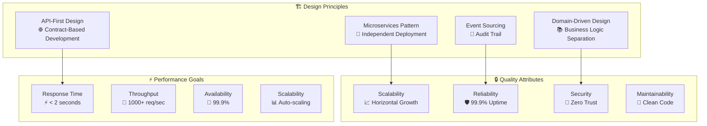

### 📐 System Context Diagram

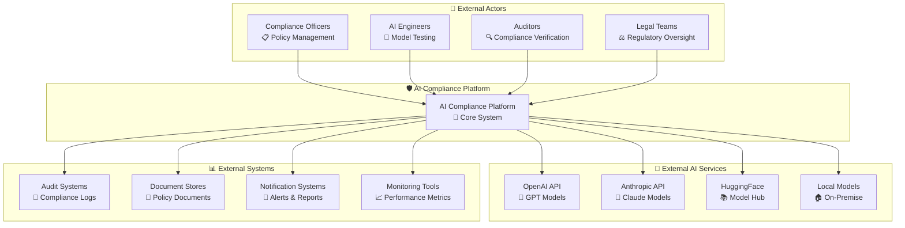

---

## 🏛️ Architecture Design

### 🎪 High-Level Architecture

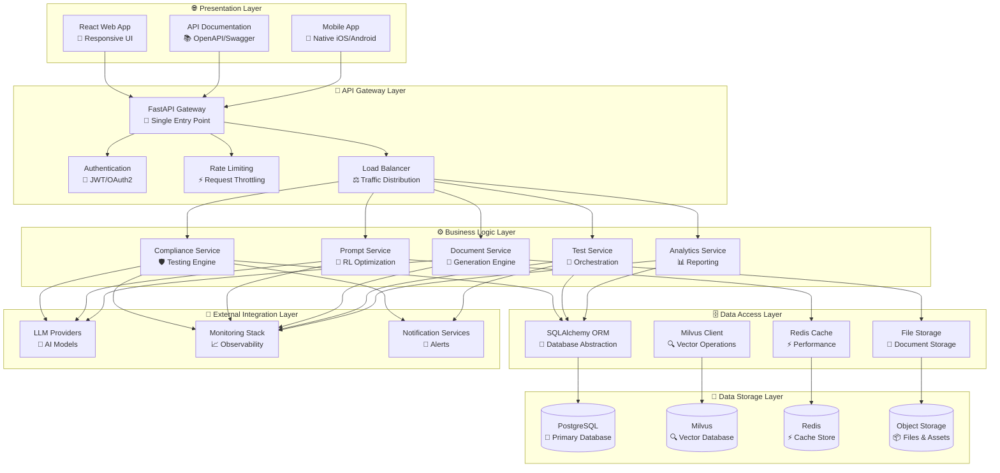

### 🔄 Data Flow Architecture

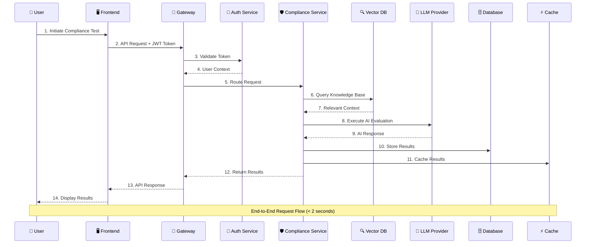

### 🔧 Component Interaction Model

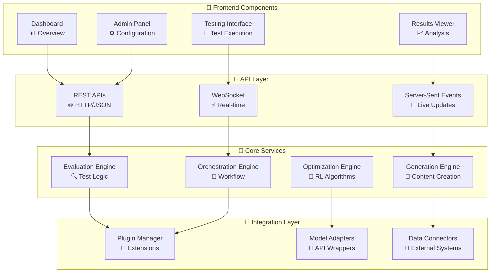

---

## 🗄️ Data Models & Schema

### 📊 Entity Relationship Diagram

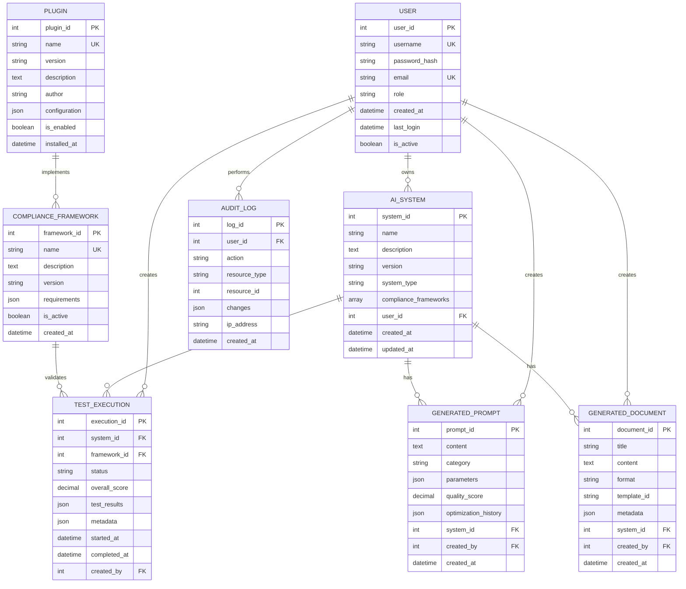

### 🏗️ Database Schema Design

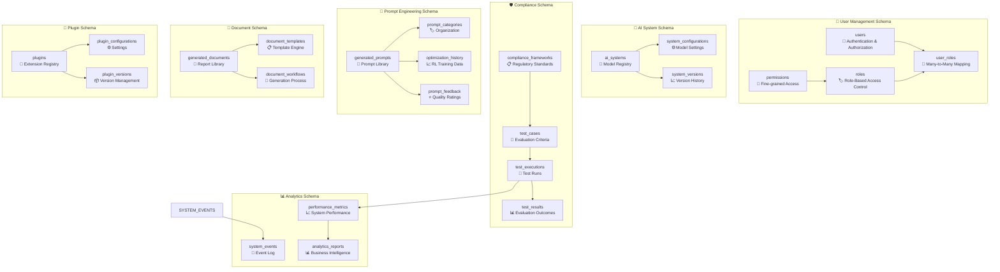

### 🔍 Vector Database Schema

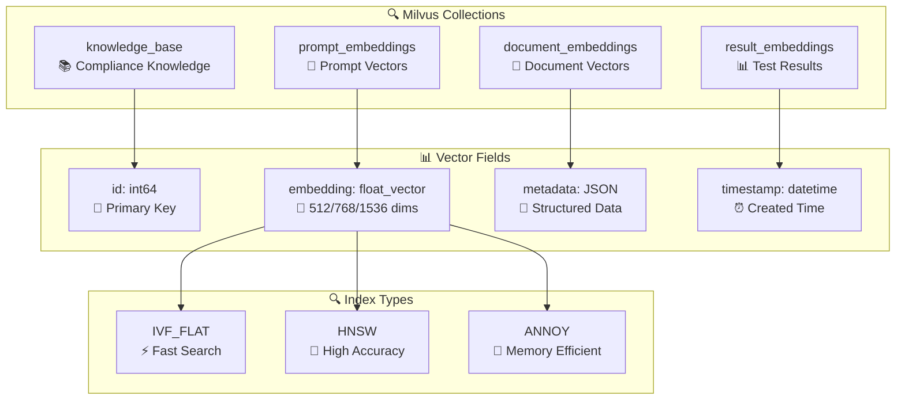

---

## ⚙️ Service Specifications

### 🛡️ Compliance Service

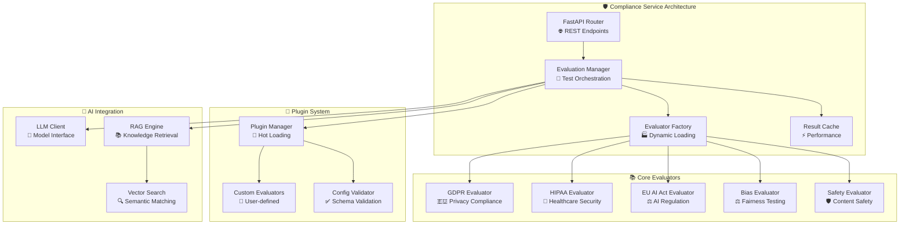

#### 📋 API Endpoints

| Endpoint | Method | Description | Request | Response |
|----------|---------|-------------|---------|----------|
| `/compliance/frameworks` | GET | List frameworks | - | Framework list |
| `/compliance/frameworks/{id}` | GET | Framework details | Framework ID | Framework spec |
| `/compliance/evaluate` | POST | Run evaluation | AI system + Framework | Test results |
| `/compliance/results/{id}` | GET | Get results | Execution ID | Detailed results |
| `/compliance/reports` | GET | List reports | Filters | Report list |
| `/compliance/export/{id}` | GET | Export results | Format type | File download |

### 🤖 Prompt Service

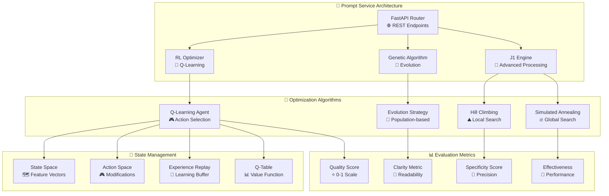

#### 🔄 RL Optimization Flow

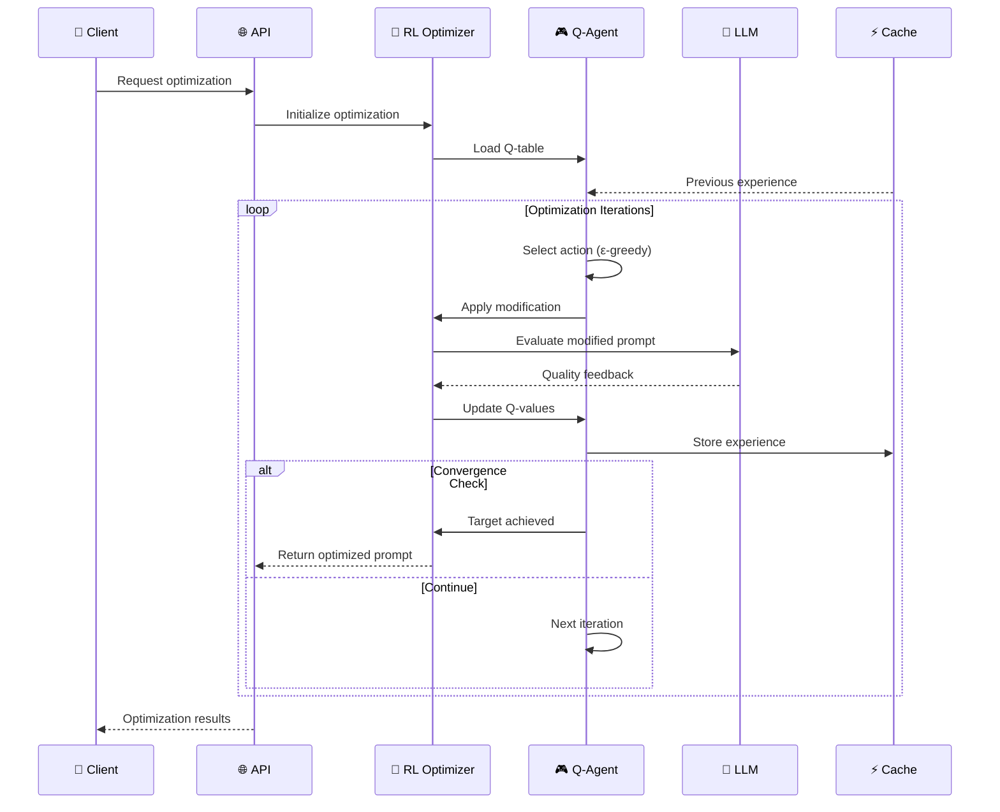

### 📄 Document Service

```mermaid
graph TB
    subgraph "📄 Document Service Architecture"
        API[FastAPI Router<br/>🌐 REST Endpoints]
        TEMPLATE_ENGINE[Template Engine<br/>📋 Jinja2/Custom]
        WORKFLOW_ENGINE[Workflow Engine<br/>🔄 Process Automation]
        FORMAT_CONVERTER[Format Converter<br/>🔄 Multi-format Export]
    end
    
    subgraph "📋 Template System"
        INDUSTRY_TEMPLATES[Industry Templates<br/>🏭 Pre-built]
        CUSTOM_TEMPLATES[Custom Templates<br/>🔧 User-defined]
        TEMPLATE_VALIDATOR[Template Validator<br/>✅ Schema Check]
        VARIABLE_RESOLVER[Variable Resolver<br/>🔍 Dynamic Content]
    end
    
    subgraph "🔄 Workflow Management"
        WORKFLOW_DEF[Workflow Definition<br/>📝 YAML/JSON]
        STEP_EXECUTOR[Step Executor<br/>🏃 Task Runner]
        CONDITION_ENGINE[Condition Engine<br/>🔀 Branching Logic]
        APPROVAL_SYSTEM[Approval System<br/>✅ Human Review]
    end
    
    subgraph "📤 Export Formats"
        PDF[PDF Export<br/>📄 Adobe Format]
        DOCX[DOCX Export<br/>📝 Microsoft Word]
        HTML[HTML Export<br/>🌐 Web Format]
        MARKDOWN[Markdown Export<br/>📋 Plain Text]
        JSON[JSON Export<br/>🔧 Structured Data]
    end
    
    API --> TEMPLATE_ENGINE
    API --> WORKFLOW_ENGINE
    API --> FORMAT_CONVERTER
    
    TEMPLATE_ENGINE --> INDUSTRY_TEMPLATES
    TEMPLATE_ENGINE --> CUSTOM_TEMPLATES
    TEMPLATE_ENGINE --> TEMPLATE_VALIDATOR
    TEMPLATE_ENGINE --> VARIABLE_RESOLVER
    
    WORKFLOW_ENGINE --> WORKFLOW_DEF
    WORKFLOW_ENGINE --> STEP_EXECUTOR
    WORKFLOW_ENGINE --> CONDITION_ENGINE
    WORKFLOW_ENGINE --> APPROVAL_SYSTEM
    
    FORMAT_CONVERTER --> PDF
    FORMAT_CONVERTER --> DOCX
    FORMAT_CONVERTER --> HTML
    FORMAT_CONVERTER --> MARKDOWN
    FORMAT_CONVERTER --> JSON
```

### 🧪 Test Service

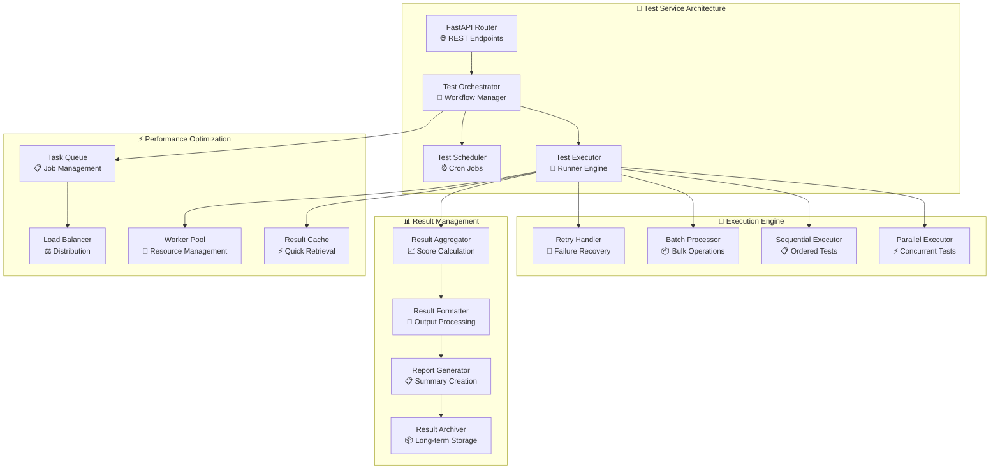

---

## 🔌 Plugin Architecture

### 🧩 Plugin System Design

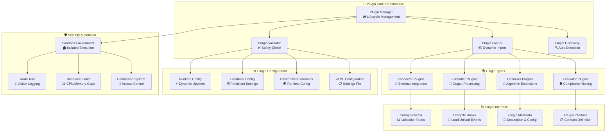

### 🔄 Plugin Lifecycle

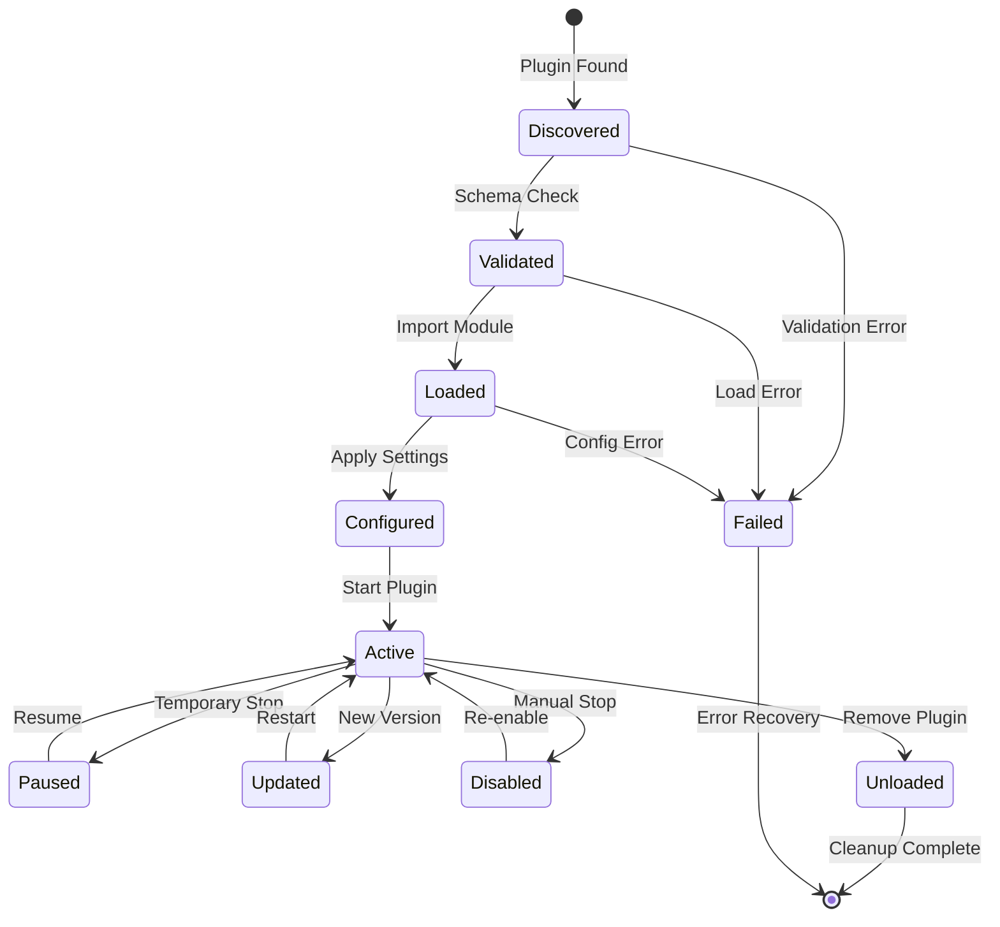

### 🏭 Plugin Factory Pattern

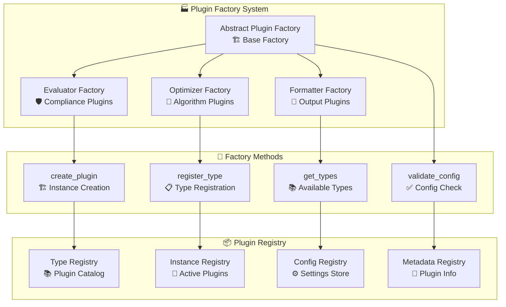

---

## 🔒 Security Design

### 🛡️ Security Architecture

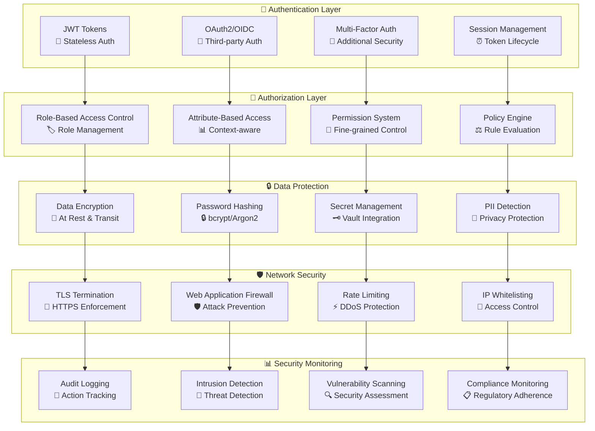

### 🔐 Authentication Flow

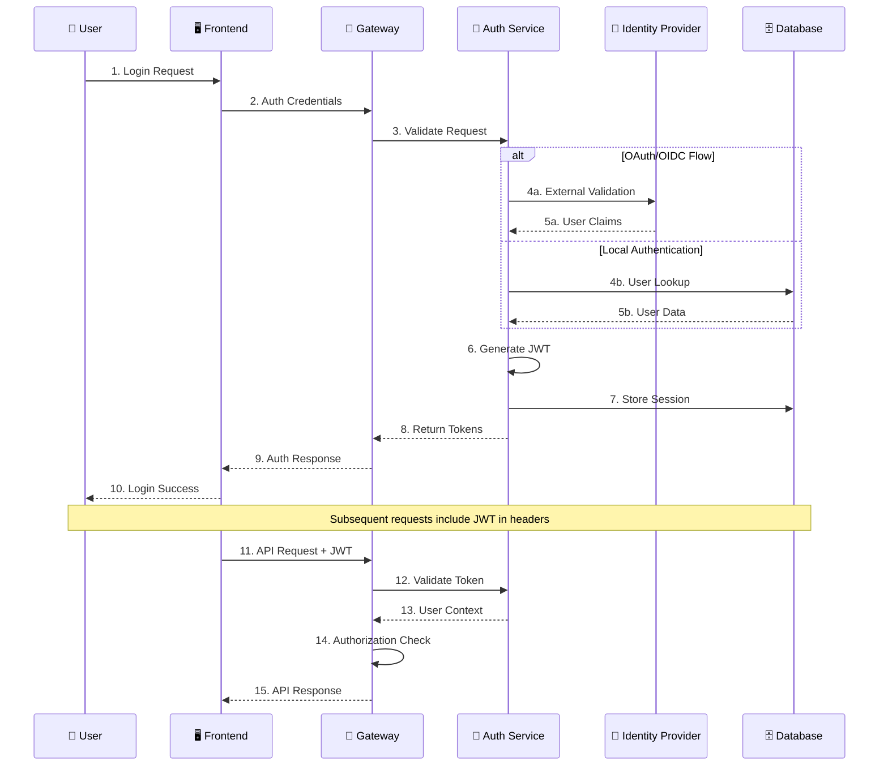

### 🛡️ Zero Trust Security Model

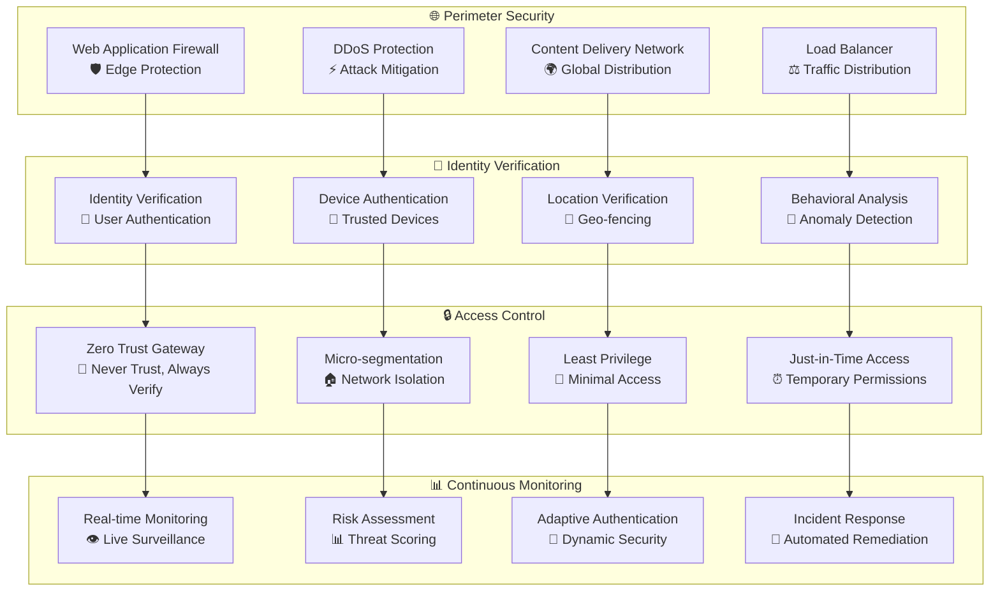

---

## ⚡ Performance & Scalability

### 📈 Scalability Architecture

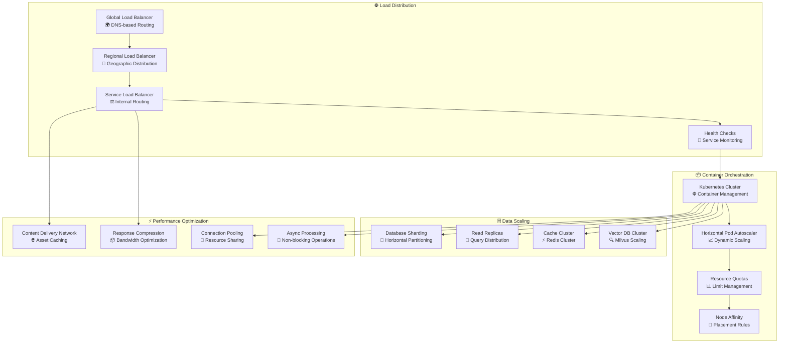

### 📊 Performance Metrics & SLAs

```mermaid
graph TB
    subgraph "⚡ Response Time SLAs"
        API_LATENCY[API Response Time<br/>🎯 Target: < 200ms<br/>📊 P95: < 500ms]
        PAGE_LOAD[Page Load Time<br/>🎯 Target: < 2s<br/>📊 P95: < 5s]
        DB_QUERY[Database Query Time<br/>🎯 Target: < 100ms<br/>📊 P95: < 300ms]
        AI_INFERENCE[AI Inference Time<br/>🎯 Target: < 2s<br/>📊 P95: < 10s]
    end
    
    subgraph "🚀 Throughput Targets"
        REQ_PER_SEC[Requests/Second<br/>🎯 Target: 1000 RPS<br/>📊 Peak: 5000 RPS]
        CONCURRENT_USERS[Concurrent Users<br/>🎯 Target: 10,000<br/>📊 Peak: 50,000]
        TEST_EXECUTIONS[Test Executions/Hour<br/>🎯 Target: 10,000<br/>📊 Peak: 50,000]
        DOCUMENT_GEN[Documents/Minute<br/>🎯 Target: 100<br/>📊 Peak: 500]
    end
    
    subgraph "🎯 Availability Targets"
        UPTIME[System Uptime<br/>🎯 Target: 99.9%<br/>📊 Monthly: 43.8min downtime]
        MTTR[Mean Time to Recovery<br/>🎯 Target: < 15min<br/>📊 P95: < 30min]
        ERROR_RATE[Error Rate<br/>🎯 Target: < 0.1%<br/>📊 P95: < 0.5%]
        HEALTH_CHECK[Health Check Success<br/>🎯 Target: 99.95%<br/>📊 5s interval]
    end
    
    subgraph "📈 Scalability Metrics"
        AUTO_SCALE_TIME[Auto-scale Response<br/>🎯 Target: < 2min<br/>📊 P95: < 5min]
        RESOURCE_UTIL[Resource Utilization<br/>🎯 Target: 70-80%<br/>📊 CPU/Memory]
        STORAGE_GROWTH[Storage Growth<br/>🎯 Monitor: Linear<br/>📊 Predictable scaling]
        COST_EFFICIENCY[Cost per Request<br/>🎯 Target: Optimize<br/>📊 Continuous improvement]
    end
    
    API_LATENCY --> REQ_PER_SEC
    PAGE_LOAD --> CONCURRENT_USERS
    DB_QUERY --> TEST_EXECUTIONS
    AI_INFERENCE --> DOCUMENT_GEN
    
    REQ_PER_SEC --> UPTIME
    CONCURRENT_USERS --> MTTR
    TEST_EXECUTIONS --> ERROR_RATE
    DOCUMENT_GEN --> HEALTH_CHECK
    
    UPTIME --> AUTO_SCALE_TIME
    MTTR --> RESOURCE_UTIL
    ERROR_RATE --> STORAGE_GROWTH
    HEALTH_CHECK --> COST_EFFICIENCY
```

### 🔄 Caching Strategy

```mermaid
graph TB
    subgraph "🎨 Frontend Caching"
        BROWSER_CACHE[Browser Cache<br/>🌐 Static Assets]
        SERVICE_WORKER[Service Worker<br/>⚡ Offline Support]
        CDN_CACHE[CDN Cache<br/>🌍 Global Distribution]
        EDGE_CACHE[Edge Cache<br/>📍 Regional Nodes]
    end
    
    subgraph "🔄 Application Caching"
        MEMORY_CACHE[In-Memory Cache<br/>⚡ Local Storage]
        REDIS_CACHE[Redis Cache<br/>🔴 Distributed Cache]
        SESSION_CACHE[Session Cache<br/>👤 User State]
        RESULT_CACHE[Result Cache<br/>📊 Computation Cache]
    end
    
    subgraph "🗄️ Database Caching"
        QUERY_CACHE[Query Cache<br/>🔍 Prepared Statements]
        RESULT_SET_CACHE[Result Set Cache<br/>📊 Query Results]
        CONNECTION_POOL[Connection Pool<br/>🔗 DB Connections]
        BUFFER_POOL[Buffer Pool<br/>💾 Page Cache]
    end
    
    subgraph "🤖 AI Model Caching"
        MODEL_CACHE[Model Cache<br/>🧠 Loaded Models]
        EMBEDDING_CACHE[Embedding Cache<br/>🔍 Vector Cache]
        RESPONSE_CACHE[Response Cache<br/>💬 AI Outputs]
        PROMPT_CACHE[Prompt Cache<br/>📝 Template Cache]
    end
    
    subgraph "⏰ Cache Policies"
        TTL[Time-to-Live<br/>⏰ Expiration]
        LRU[Least Recently Used<br/>🔄 Eviction Policy]
        WRITE_THROUGH[Write-through<br/>✍️ Immediate Update]
        WRITE_BEHIND[Write-behind<br/>⏳ Delayed Update]
    end
    
    BROWSER_CACHE --> MEMORY_CACHE
    SERVICE_WORKER --> REDIS_CACHE
    CDN_CACHE --> SESSION_CACHE
    EDGE_CACHE --> RESULT_CACHE
    
    MEMORY_CACHE --> QUERY_CACHE
    REDIS_CACHE --> RESULT_SET_CACHE
    SESSION_CACHE --> CONNECTION_POOL
    RESULT_CACHE --> BUFFER_POOL
    
    QUERY_CACHE --> MODEL_CACHE
    RESULT_SET_CACHE --> EMBEDDING_CACHE
    CONNECTION_POOL --> RESPONSE_CACHE
    BUFFER_POOL --> PROMPT_CACHE
    
    MODEL_CACHE --> TTL
    EMBEDDING_CACHE --> LRU
    RESPONSE_CACHE --> WRITE_THROUGH
    PROMPT_CACHE --> WRITE_BEHIND
```

---

## 🔗 Integration Patterns

### 🌐 External System Integration

```mermaid
graph TB
    subgraph "🤖 AI/ML Services"
        OPENAI_API[OpenAI API<br/>🧠 GPT Models]
        ANTHROPIC_API[Anthropic API<br/>🤖 Claude Models]
        HUGGINGFACE_API[HuggingFace API<br/>🤗 Model Hub]
        LOCAL_MODELS[Local Models<br/>🏠 On-premise Inference]
    end
    
    subgraph "🔧 Integration Patterns"
        ADAPTER_PATTERN[Adapter Pattern<br/>🔄 API Normalization]
        CIRCUIT_BREAKER[Circuit Breaker<br/>⚡ Fault Tolerance]
        RETRY_MECHANISM[Retry Mechanism<br/>🔄 Error Recovery]
        BULKHEAD[Bulkhead Pattern<br/>🚢 Resource Isolation]
    end
    
    subgraph "📊 Monitoring Integration"
        PROMETHEUS[Prometheus<br/>📈 Metrics Collection]
        GRAFANA[Grafana<br/>📊 Visualization]
        JAEGER[Jaeger<br/>🔍 Distributed Tracing]
        ELK_STACK[ELK Stack<br/>📝 Log Management]
    end
    
    subgraph "🔐 Security Integration"
        VAULT[HashiCorp Vault<br/>🗝️ Secret Management]
        KEYCLOAK[Keycloak<br/>🔐 Identity Management]
        FALCO[Falco<br/>👁️ Runtime Security]
        AQUA[Aqua Security<br/>🐳 Container Security]
    end
    
    subgraph "☁️ Cloud Services"
        AWS_SERVICES[AWS Services<br/>☁️ EC2, S3, RDS]
        AZURE_SERVICES[Azure Services<br/>🔷 VMs, Blob, SQL]
        GCP_SERVICES[GCP Services<br/>🌈 Compute, Storage]
        MULTI_CLOUD[Multi-cloud<br/>🌍 Vendor Independence]
    end
    
    OPENAI_API --> ADAPTER_PATTERN
    ANTHROPIC_API --> CIRCUIT_BREAKER
    HUGGINGFACE_API --> RETRY_MECHANISM
    LOCAL_MODELS --> BULKHEAD
    
    ADAPTER_PATTERN --> PROMETHEUS
    CIRCUIT_BREAKER --> GRAFANA
    RETRY_MECHANISM --> JAEGER
    BULKHEAD --> ELK_STACK
    
    PROMETHEUS --> VAULT
    GRAFANA --> KEYCLOAK
    JAEGER --> FALCO
    ELK_STACK --> AQUA
    
    VAULT --> AWS_SERVICES
    KEYCLOAK --> AZURE_SERVICES
    FALCO --> GCP_SERVICES
    AQUA --> MULTI_CLOUD
```

### 🔄 API Integration Architecture

```mermaid
sequenceDiagram
    participant Client as 📱 Client Application
    participant Gateway as 🚪 API Gateway
    participant Service as ⚙️ Microservice
    participant Circuit as ⚡ Circuit Breaker
    participant External as 🌐 External API
    participant Monitor as 📊 Monitoring
    
    Client->>Gateway: 1. API Request
    Gateway->>Service: 2. Route Request
    Service->>Circuit: 3. External Call
    
    alt Circuit Open (Healthy)
        Circuit->>External: 4a. API Call
        External-->>Circuit: 5a. Response
        Circuit-->>Service: 6a. Success
    else Circuit Half-Open (Testing)
        Circuit->>External: 4b. Test Call
        alt Success
            External-->>Circuit: 5b. Success
            Circuit->>Circuit: Reset Circuit
        else Failure
            Circuit->>Circuit: Keep Open
            Circuit-->>Service: 6b. Fallback Response
        end
    else Circuit Closed (Failing)
        Circuit-->>Service: 4c. Immediate Fallback
    end
    
    Service->>Monitor: 7. Log Metrics
    Service-->>Gateway: 8. Response
    Gateway-->>Client: 9. Final Response
    
    Note over Client,Monitor: End-to-End Integration with Resilience
```

---

## 📊 Monitoring & Observability

### 👁️ Observability Stack

```mermaid
graph TB
    subgraph "📈 Metrics Collection"
        PROMETHEUS[Prometheus<br/>📊 Time-series DB]
        NODE_EXPORTER[Node Exporter<br/>🖥️ System Metrics]
        APP_METRICS[Application Metrics<br/>⚙️ Custom Metrics]
        BUSINESS_METRICS[Business Metrics<br/>💼 KPI Tracking]
    end
    
    subgraph "📝 Logging Pipeline"
        FLUENTD[Fluentd<br/>🌊 Log Aggregation]
        ELASTICSEARCH[Elasticsearch<br/>🔍 Search Engine]
        LOGSTASH[Logstash<br/>🔄 Log Processing]
        KIBANA[Kibana<br/>📊 Log Visualization]
    end
    
    subgraph "🔍 Distributed Tracing"
        JAEGER[Jaeger<br/>🕵️ Trace Collection]
        OPENTELEMETRY[OpenTelemetry<br/>📡 Instrumentation]
        SPAN_COLLECTOR[Span Collector<br/>📦 Trace Aggregation]
        TRACE_STORAGE[Trace Storage<br/>💾 Historical Data]
    end
    
    subgraph "📊 Visualization & Alerting"
        GRAFANA[Grafana<br/>📈 Dashboards]
        ALERTMANAGER[AlertManager<br/>🚨 Alert Routing]
        PAGERDUTY[PagerDuty<br/>📱 Incident Management]
        SLACK[Slack Integration<br/>💬 Team Notifications]
    end
    
    subgraph "🧠 AI-Powered Monitoring"
        ANOMALY_DETECTION[Anomaly Detection<br/>🤖 ML-based Alerts]
        PREDICTIVE_SCALING[Predictive Scaling<br/>📈 Proactive Scaling]
        ROOT_CAUSE[Root Cause Analysis<br/>🔍 Automated Diagnosis]
        HEALTH_SCORING[Health Scoring<br/>⭐ System Health]
    end
    
    PROMETHEUS --> GRAFANA
    NODE_EXPORTER --> PROMETHEUS
    APP_METRICS --> PROMETHEUS
    BUSINESS_METRICS --> PROMETHEUS
    
    FLUENTD --> ELASTICSEARCH
    ELASTICSEARCH --> KIBANA
    LOGSTASH --> ELASTICSEARCH
    
    JAEGER --> TRACE_STORAGE
    OPENTELEMETRY --> JAEGER
    SPAN_COLLECTOR --> JAEGER
    
    GRAFANA --> ALERTMANAGER
    ALERTMANAGER --> PAGERDUTY
    ALERTMANAGER --> SLACK
    
    PROMETHEUS --> ANOMALY_DETECTION
    GRAFANA --> PREDICTIVE_SCALING
    JAEGER --> ROOT_CAUSE
    ANOMALY_DETECTION --> HEALTH_SCORING
```

### 📊 Key Performance Indicators (KPIs)

```mermaid
graph TB
    subgraph "⚡ System Performance KPIs"
        RESPONSE_TIME[Average Response Time<br/>🎯 Target: < 200ms]
        THROUGHPUT[Requests per Second<br/>🚀 Target: 1000+ RPS]
        ERROR_RATE[Error Rate<br/>❌ Target: < 0.1%]
        UPTIME[System Uptime<br/>✅ Target: 99.9%]
    end
    
    subgraph "💼 Business KPIs"
        TEST_COMPLETION[Test Completion Rate<br/>✅ Target: 95%]
        USER_SATISFACTION[User Satisfaction Score<br/>⭐ Target: 4.5/5]
        COMPLIANCE_SCORE[Compliance Score<br/>📋 Target: 90%+]
        COST_PER_TEST[Cost per Test<br/>💰 Optimize]
    end
    
    subgraph "🔒 Security KPIs"
        VULNERABILITY_COUNT[Open Vulnerabilities<br/>🔍 Target: 0 Critical]
        FAILED_LOGINS[Failed Login Attempts<br/>🚫 Monitor Anomalies]
        SECURITY_INCIDENTS[Security Incidents<br/>🚨 Target: 0/month]
        COMPLIANCE_AUDIT[Audit Findings<br/>📋 Target: 0 Major]
    end
    
    subgraph "👥 User Experience KPIs"
        PAGE_LOAD_TIME[Page Load Time<br/>⚡ Target: < 2s]
        USER_ENGAGEMENT[User Engagement<br/>📈 Monitor Trends]
        FEATURE_ADOPTION[Feature Adoption Rate<br/>📊 Track Usage]
        SUPPORT_TICKETS[Support Tickets<br/>🎫 Target: < 10/week]
    end
    
    subgraph "📈 Operational KPIs"
        DEPLOYMENT_FREQUENCY[Deployment Frequency<br/>🚀 Weekly Releases]
        LEAD_TIME[Lead Time<br/>⏰ Feature to Production]
        CHANGE_FAILURE_RATE[Change Failure Rate<br/>❌ Target: < 5%]
        MTTR[Mean Time to Recovery<br/>🔧 Target: < 15min]
    end
    
    RESPONSE_TIME --> TEST_COMPLETION
    THROUGHPUT --> USER_SATISFACTION
    ERROR_RATE --> COMPLIANCE_SCORE
    UPTIME --> COST_PER_TEST
    
    TEST_COMPLETION --> VULNERABILITY_COUNT
    USER_SATISFACTION --> FAILED_LOGINS
    COMPLIANCE_SCORE --> SECURITY_INCIDENTS
    COST_PER_TEST --> COMPLIANCE_AUDIT
    
    VULNERABILITY_COUNT --> PAGE_LOAD_TIME
    FAILED_LOGINS --> USER_ENGAGEMENT
    SECURITY_INCIDENTS --> FEATURE_ADOPTION
    COMPLIANCE_AUDIT --> SUPPORT_TICKETS
    
    PAGE_LOAD_TIME --> DEPLOYMENT_FREQUENCY
    USER_ENGAGEMENT --> LEAD_TIME
    FEATURE_ADOPTION --> CHANGE_FAILURE_RATE
    SUPPORT_TICKETS --> MTTR
```

### 🚨 Alerting Strategy

```mermaid
graph TB
    subgraph "🔍 Alert Sources"
        METRIC_ALERTS[Metric-based Alerts<br/>📊 Threshold Violations]
        LOG_ALERTS[Log-based Alerts<br/>📝 Error Patterns]
        TRACE_ALERTS[Trace-based Alerts<br/>🔍 Performance Issues]
        HEALTH_ALERTS[Health Check Alerts<br/>💓 Service Failures]
    end
    
    subgraph "⚡ Alert Severity Levels"
        CRITICAL[Critical<br/>🔴 Immediate Action]
        HIGH[High<br/>🟠 Urgent Attention]
        MEDIUM[Medium<br/>🟡 Investigation Needed]
        LOW[Low<br/>🟢 Informational]
    end
    
    subgraph "📱 Alert Channels"
        PAGERDUTY_ALERT[PagerDuty<br/>📱 On-call Escalation]
        SLACK_ALERT[Slack<br/>💬 Team Notifications]
        EMAIL_ALERT[Email<br/>📧 Detailed Reports]
        SMS_ALERT[SMS<br/>📱 Critical Only]
    end
    
    subgraph "🧠 Alert Intelligence"
        CORRELATION[Alert Correlation<br/>🔗 Related Events]
        SUPPRESSION[Alert Suppression<br/>🤫 Noise Reduction]
        ESCALATION[Auto-escalation<br/>📈 Severity Increase]
        RESOLUTION[Auto-resolution<br/>✅ Self-healing]
    end
    
    subgraph "📊 Alert Analytics"
        ALERT_TRENDS[Alert Trends<br/>📈 Pattern Analysis]
        MTTR_TRACKING[MTTR Tracking<br/>⏰ Response Time]
        FALSE_POSITIVE[False Positive Rate<br/>❌ Alert Quality]
        COVERAGE_ANALYSIS[Coverage Analysis<br/>🎯 Gap Identification]
    end
    
    METRIC_ALERTS --> CRITICAL
    LOG_ALERTS --> HIGH
    TRACE_ALERTS --> MEDIUM
    HEALTH_ALERTS --> LOW
    
    CRITICAL --> PAGERDUTY_ALERT
    HIGH --> SLACK_ALERT
    MEDIUM --> EMAIL_ALERT
    LOW --> SMS_ALERT
    
    PAGERDUTY_ALERT --> CORRELATION
    SLACK_ALERT --> SUPPRESSION
    EMAIL_ALERT --> ESCALATION
    SMS_ALERT --> RESOLUTION
    
    CORRELATION --> ALERT_TRENDS
    SUPPRESSION --> MTTR_TRACKING
    ESCALATION --> FALSE_POSITIVE
    RESOLUTION --> COVERAGE_ANALYSIS
```

---

## 🚀 Deployment Strategy

### 🏗️ Infrastructure as Code

```mermaid
graph TB
    subgraph "📋 Infrastructure Definition"
        TERRAFORM[Terraform<br/>🏗️ Infrastructure Provisioning]
        ANSIBLE[Ansible<br/>⚙️ Configuration Management]
        HELM[Helm Charts<br/>📦 Kubernetes Packaging]
        KUSTOMIZE[Kustomize<br/>🔧 K8s Customization]
    end
    
    subgraph "🔄 CI/CD Pipeline"
        GIT_TRIGGER[Git Trigger<br/>📝 Code Changes]
        BUILD_STAGE[Build Stage<br/>🔨 Compilation & Testing]
        SECURITY_SCAN[Security Scan<br/>🔍 Vulnerability Check]
        DEPLOY_STAGE[Deploy Stage<br/>🚀 Environment Rollout]
    end
    
    subgraph "🌍 Environment Strategy"
        DEV_ENV[Development<br/>💻 Feature Development]
        STAGING_ENV[Staging<br/>🎭 Pre-production Testing]
        PROD_ENV[Production<br/>🏭 Live Environment]
        DR_ENV[Disaster Recovery<br/>🛡️ Backup Environment]
    end
    
    subgraph "📊 Deployment Patterns"
        BLUE_GREEN[Blue-Green<br/>🔄 Zero Downtime]
        CANARY[Canary Release<br/>🐦 Gradual Rollout]
        ROLLING[Rolling Update<br/>🔄 Sequential Replacement]
        FEATURE_FLAGS[Feature Flags<br/>🚩 Toggle Features]
    end
    
    subgraph "🔍 Validation & Rollback"
        HEALTH_CHECKS[Health Checks<br/>💓 Service Validation]
        SMOKE_TESTS[Smoke Tests<br/>💨 Basic Functionality]
        ROLLBACK_MECHANISM[Rollback Mechanism<br/>↩️ Automatic Revert]
        MONITORING_VALIDATION[Monitoring Validation<br/>📊 Metric Verification]
    end
    
    TERRAFORM --> GIT_TRIGGER
    ANSIBLE --> BUILD_STAGE
    HELM --> SECURITY_SCAN
    KUSTOMIZE --> DEPLOY_STAGE
    
    GIT_TRIGGER --> DEV_ENV
    BUILD_STAGE --> STAGING_ENV
    SECURITY_SCAN --> PROD_ENV
    DEPLOY_STAGE --> DR_ENV
    
    DEV_ENV --> BLUE_GREEN
    STAGING_ENV --> CANARY
    PROD_ENV --> ROLLING
    DR_ENV --> FEATURE_FLAGS
    
    BLUE_GREEN --> HEALTH_CHECKS
    CANARY --> SMOKE_TESTS
    ROLLING --> ROLLBACK_MECHANISM
    FEATURE_FLAGS --> MONITORING_VALIDATION
```

### 🔄 Continuous Deployment Pipeline

```mermaid
graph LR
    subgraph "📝 Source Control"
        COMMIT[Code Commit<br/>📝 Developer Push]
        PR[Pull Request<br/>🔄 Code Review]
        MERGE[Merge to Main<br/>✅ Approved Changes]
    end
    
    subgraph "🔨 Build & Test"
        UNIT_TESTS[Unit Tests<br/>🧪 Component Testing]
        INTEGRATION_TESTS[Integration Tests<br/>🔗 Service Testing]
        SECURITY_TESTS[Security Tests<br/>🔒 Vulnerability Scan]
        PERFORMANCE_TESTS[Performance Tests<br/>⚡ Load Testing]
    end
    
    subgraph "📦 Artifact Creation"
        DOCKER_BUILD[Docker Build<br/>🐳 Container Images]
        HELM_PACKAGE[Helm Package<br/>📦 K8s Charts]
        ARTIFACT_REGISTRY[Artifact Registry<br/>📚 Version Storage]
    end
    
    subgraph "🚀 Deployment"
        DEV_DEPLOY[Dev Deployment<br/>💻 Automatic]
        STAGING_DEPLOY[Staging Deployment<br/>🎭 Automatic]
        PROD_DEPLOY[Prod Deployment<br/>🏭 Manual Approval]
    end
    
    subgraph "✅ Validation"
        SMOKE_TESTING[Smoke Testing<br/>💨 Basic Validation]
        HEALTH_MONITORING[Health Monitoring<br/>💓 Service Check]
        ROLLBACK_TRIGGER[Rollback Trigger<br/>↩️ Failure Detection]
    end
    
    COMMIT --> PR
    PR --> MERGE
    
    MERGE --> UNIT_TESTS
    UNIT_TESTS --> INTEGRATION_TESTS
    INTEGRATION_TESTS --> SECURITY_TESTS
    SECURITY_TESTS --> PERFORMANCE_TESTS
    
    PERFORMANCE_TESTS --> DOCKER_BUILD
    DOCKER_BUILD --> HELM_PACKAGE
    HELM_PACKAGE --> ARTIFACT_REGISTRY
    
    ARTIFACT_REGISTRY --> DEV_DEPLOY
    DEV_DEPLOY --> STAGING_DEPLOY
    STAGING_DEPLOY --> PROD_DEPLOY
    
    DEV_DEPLOY --> SMOKE_TESTING
    STAGING_DEPLOY --> HEALTH_MONITORING
    PROD_DEPLOY --> ROLLBACK_TRIGGER
```

---

## 🗺️ Future Roadmap

### 📅 Development Timeline

```mermaid
gantt
    title AI Compliance Platform Roadmap
    dateFormat  YYYY-MM-DD
    section Phase 1 - Foundation
    Core Architecture        :done, foundation, 2024-01-01, 2024-03-31
    Basic Compliance Testing :done, basic-testing, 2024-02-01, 2024-04-30
    Simple UI Development    :done, basic-ui, 2024-03-01, 2024-05-31
    
    section Phase 2 - Enhancement
    Plugin System           :done, plugins, 2024-04-01, 2024-06-30
    RL Optimization         :done, rl-opt, 2024-05-01, 2024-07-31
    Advanced RAG            :done, rag, 2024-06-01, 2024-08-31
    
    section Phase 3 - Enterprise
    Multi-tenant Support    :active, multi-tenant, 2024-07-01, 2024-09-30
    Enterprise Security     :active, enterprise-sec, 2024-08-01, 2024-10-31
    Advanced Analytics      :advanced-analytics, 2024-09-01, 2024-11-30
    
    section Phase 4 - AI Enhancement
    Neural Network Optimization :neural-opt, 2024-10-01, 2024-12-31
    Federated Learning          :federated, 2024-11-01, 2025-01-31
    AutoML Integration          :automl, 2024-12-01, 2025-02-28
    
    section Phase 5 - Scale
    Global Deployment       :global, 2025-01-01, 2025-03-31
    Edge Computing          :edge, 2025-02-01, 2025-04-30
    Quantum-Ready Architecture :quantum, 2025-03-01, 2025-05-31
```

### 🚀 Technology Evolution

```mermaid
graph TB
    subgraph "🎯 Current State (v1.3)"
        CURRENT_TECH[Current Technology Stack<br/>⚡ FastAPI, React, PostgreSQL<br/>🔍 Milvus, Redis, Docker]
    end
    
    subgraph "📈 Near-term Evolution (v2.0)"
        ENHANCED_AI[Enhanced AI Capabilities<br/>🧠 GPT-4, Claude-3, Local LLMs<br/>🤖 Multi-modal Processing]
        ADVANCED_ANALYTICS[Advanced Analytics<br/>📊 Real-time Dashboards<br/>🔍 Predictive Insights]
        EDGE_COMPUTING[Edge Computing<br/>🌐 Distributed Processing<br/>⚡ Low Latency Inference]
    end
    
    subgraph "🌟 Mid-term Goals (v3.0)"
        NEURAL_ARCHITECTURE[Neural Architecture Search<br/>🧬 Automated Model Design<br/>🔬 Self-optimizing Systems]
        FEDERATED_LEARNING[Federated Learning<br/>🌍 Distributed Training<br/>🔒 Privacy-preserving ML]
        QUANTUM_INTEGRATION[Quantum Integration<br/>⚛️ Quantum Algorithms<br/>🚀 Exponential Speedup]
    end
    
    subgraph "🔮 Long-term Vision (v4.0+)"
        AGI_INTEGRATION[AGI Integration<br/>🧠 Artificial General Intelligence<br/>🎯 Human-level Reasoning]
        AUTONOMOUS_COMPLIANCE[Autonomous Compliance<br/>🤖 Self-governing Systems<br/>⚖️ Automated Regulation]
        UNIVERSAL_PLATFORM[Universal Platform<br/>🌍 Cross-industry Solution<br/>🏛️ Global Standard]
    end
    
    CURRENT_TECH --> ENHANCED_AI
    ENHANCED_AI --> NEURAL_ARCHITECTURE
    NEURAL_ARCHITECTURE --> AGI_INTEGRATION
    
    CURRENT_TECH --> ADVANCED_ANALYTICS
    ADVANCED_ANALYTICS --> FEDERATED_LEARNING
    FEDERATED_LEARNING --> AUTONOMOUS_COMPLIANCE
    
    CURRENT_TECH --> EDGE_COMPUTING
    EDGE_COMPUTING --> QUANTUM_INTEGRATION
    QUANTUM_INTEGRATION --> UNIVERSAL_PLATFORM
```

### 🎯 Strategic Initiatives

```mermaid
mindmap
  root((AI Compliance Platform Future))
    Research & Development
      Quantum Computing Integration
      Neuromorphic Processing
      Biological Computing
      DNA Storage Systems
    
    Market Expansion
      Industry Verticals
        Healthcare
        Finance
        Automotive
        Aerospace
      Geographic Regions
        North America
        Europe
        Asia Pacific
        Global South
    
    Technology Innovation
      AI/ML Advancement
        Transformer Models
        Diffusion Models
        Reinforcement Learning
        Meta-learning
      Infrastructure Evolution
        Serverless Architecture
        Event-driven Systems
        Microkernel Design
        Self-healing Systems
    
    Ecosystem Development
      Partner Network
        Technology Partners
        System Integrators
        Consulting Firms
        Academic Institutions
      Developer Community
        Open Source Components
        Plugin Marketplace
        Developer Tools
        Training Programs
    
    Regulatory Alignment
      Emerging Regulations
        AI Act (EU)
        GDPR Extensions
        Industry-specific Rules
        Global Standards
      Compliance Automation
        Real-time Monitoring
        Predictive Compliance
        Automated Reporting
        Risk Assessment
```

---

## 📋 Conclusion

### 🎯 Design Summary

The **AI Compliance Platform** represents a comprehensive, enterprise-grade solution that addresses the critical need for systematic AI compliance testing and management. Built on modern microservices architecture with extensive observability, security, and scalability features, the platform provides:

- **🏛️ Robust Architecture**: Microservices-based design with clear separation of concerns
- **🔌 Extensible Plugin System**: Hot-loadable compliance evaluators for any framework
- **🤖 AI-Powered Optimization**: Reinforcement learning for intelligent prompt optimization
- **📊 Comprehensive Monitoring**: Full observability stack with AI-powered insights
- **🔒 Enterprise Security**: Zero-trust architecture with comprehensive audit trails
- **⚡ High Performance**: Sub-2s response times with horizontal scalability

### 🚀 Key Success Factors

1. **📐 Architectural Excellence**: Clean, maintainable code with SOLID principles
2. **🔧 Developer Experience**: Comprehensive tooling and documentation
3. **📊 Data-Driven Decisions**: Metrics and analytics guiding development
4. **🔒 Security First**: Built-in security at every layer
5. **🌍 Global Scale**: Multi-region deployment with edge computing
6. **🤝 Community Driven**: Open plugin ecosystem and developer community

### 🔮 Future Vision

The platform is designed to evolve with the rapidly changing AI landscape, incorporating emerging technologies while maintaining stability and reliability. The roadmap includes quantum computing integration, federated learning capabilities, and eventual progression toward autonomous compliance management.

---

<div align="center">

### 🛡️ Built for the Future of AI Compliance

**Intelligent** • **Secure** • **Scalable** • **Compliant**

*Design Document v1.3 | AI Compliance Platform*

</div>