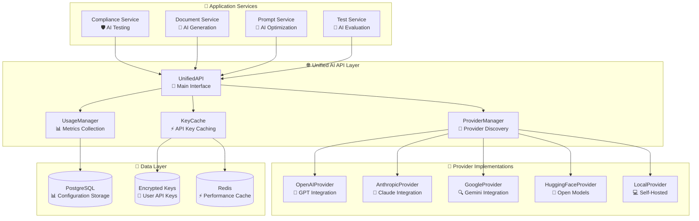
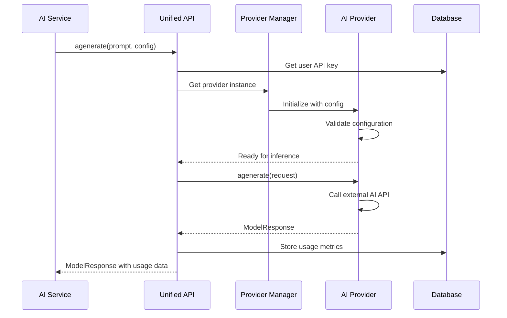

# 🤖 Unified AI API System

> **Complete technical documentation for the model-agnostic AI integration system**

## 📋 Table of Contents

- [Overview](#-overview)
- [Architecture](#-architecture)
- [Quick Start](#-quick-start)
- [API Reference](#-api-reference)
- [Provider Integration](#-provider-integration)
- [Configuration Management](#-configuration-management)
- [Security](#-security)
- [Usage Tracking](#-usage-tracking)
- [Testing](#-testing)
- [Troubleshooting](#-troubleshooting)

## 🎯 Overview

The **Unified AI API System** is the cornerstone of AI integration across the entire governance suite. It provides a **single, consistent interface** for all AI-powered features while maintaining complete **model agnosticism** and **vendor independence**.

### Key Benefits

| Benefit | Description | Impact |
|---------|-------------|---------|
| **🔄 Zero Vendor Lock-in** | Switch between OpenAI, Anthropic, Google, etc. without code changes | Future-proof architecture |
| **⚙️ User Configurable** | All models configured dynamically via database | No deployment needed for new models |
| **🔐 Enterprise Security** | Encrypted API key storage with user isolation | Production-ready security |
| **📊 Cost Optimization** | Choose optimal models per task with usage tracking | Reduced operational costs |
| **🚀 Rapid Development** | Consistent API across all services | Faster feature delivery |

### Model Agnostic Principles

```python
# ✅ GOOD: Model agnostic approach
config = ModelConfig(
    provider=user_settings.preferred_provider,  # Dynamic
    model_id=user_settings.preferred_model,     # User configured
    api_key=await get_user_api_key(user_id),    # From database
)

# ❌ BAD: Hardcoded approach  
openai_client = OpenAI(api_key="hardcoded-key")
response = openai_client.chat.completions.create(
    model="gpt-4",  # Hardcoded model
)
```

## 🏗️ Architecture

### System Components



### Data Flow



## ⚡ Quick Start

### Basic Usage

```python
from shared.unified_api import get_unified_api, ModelConfig

# 1. Create configuration
config = ModelConfig(
    provider="google",                    # Provider choice
    model_id="gemini-2.0-flash-exp",     # Model selection
    api_key="your-api-key",              # Authentication
    temperature=0.7,                     # Generation parameters
    max_tokens=1000
)

# 2. Get unified API instance
unified_api = get_unified_api()

# 3. Generate response
response = await unified_api.agenerate(
    prompt="Analyze this document for compliance issues...",
    config=config
)

# 4. Handle response
if response.error:
    print(f"Error: {response.error.message}")
else:
    print(f"Response: {response.content}")
    print(f"Usage: {response.usage}")
```

### Service Integration Pattern

```python
# Standard pattern for service integration
class ComplianceAnalyzer:
    def __init__(self):
        self.unified_api = get_unified_api()
    
    async def analyze_document(self, document: str, user_id: int) -> AnalysisResult:
        # 1. Get user's preferred configuration
        config = await self.get_user_ai_config(user_id, task_type="compliance")
        
        # 2. Build analysis prompt
        prompt = self.build_compliance_prompt(document)
        
        # 3. Generate AI response
        response = await self.unified_api.agenerate(prompt, config)
        
        # 4. Process and return results
        if response.error:
            raise AIAnalysisError(response.error.message)
            
        return AnalysisResult(
            content=response.content,
            confidence=response.metadata.get("confidence"),
            model_used=response.model_id,
            usage=response.usage
        )
```

## 📚 API Reference

### Core Classes

#### `ModelConfig`

Configuration for AI model inference.

```python
@dataclass
class ModelConfig:
    provider: str                                    # Required: "openai", "anthropic", "google", etc.
    model_id: str                                   # Required: Model identifier
    api_key: Optional[str] = None                   # API key (can be loaded from database)
    api_url: Optional[str] = None                   # Custom endpoint URL
    temperature: float = 0.7                        # Generation randomness (0.0-2.0)
    max_tokens: int = 1000                          # Maximum output tokens
    timeout: int = 30                               # Request timeout in seconds
    max_retries: int = 3                            # Number of retry attempts
    retry_delay: float = 1.0                        # Delay between retries
    provider_options: Dict[str, Any] = field(default_factory=dict)  # Provider-specific options
    usage_type: ModelType = ModelType.UTILITY       # For usage classification
    metadata: Dict[str, Any] = field(default_factory=dict)  # Additional metadata
```

#### `ModelRequest`

Standardized request format for all providers.

```python
@dataclass
class ModelRequest:
    prompt: str                                     # Main prompt text
    system_prompt: Optional[str] = None             # System/instruction prompt
    messages: Optional[List[Dict[str, str]]] = None # Chat format messages
    context: Optional[List[str]] = None             # RAG context documents
    temperature: Optional[float] = None             # Override config temperature
    max_tokens: Optional[int] = None                # Override config max_tokens
    metadata: Dict[str, Any] = field(default_factory=dict)  # Request metadata
```

#### `ModelResponse`

Unified response format from all providers.

```python
@dataclass
class ModelResponse:
    content: str                                    # Generated content
    model_id: str                                   # Model that generated response
    provider: str                                   # Provider used
    usage: Optional[UsageInfo] = None               # Token usage information
    error: Optional[APIErrorDetail] = None          # Error details if failed
    metadata: Dict[str, Any] = field(default_factory=dict)  # Provider-specific data
    response_time: Optional[float] = None           # Response time in seconds
    created_at: Optional[datetime] = None           # Response timestamp
```

### Core Methods

#### `UnifiedAPI.agenerate()`

Main async method for AI generation.

```python
async def agenerate(
    self, 
    prompt: str, 
    config: ModelConfig,
    system_prompt: Optional[str] = None,
    context: Optional[List[str]] = None,
    **kwargs
) -> ModelResponse:
    """
    Generate AI response using specified configuration.
    
    Args:
        prompt: Input prompt text
        config: Model configuration
        system_prompt: Optional system prompt
        context: Optional context documents for RAG
        **kwargs: Additional provider-specific parameters
        
    Returns:
        ModelResponse with generated content and metadata
        
    Raises:
        ConfigurationError: Invalid configuration
        ProviderError: Provider-specific error
        APIError: External API error
    """
```

#### `UnifiedAPI.generate()`

Synchronous version of `agenerate()`.

```python
def generate(
    self, 
    prompt: str, 
    config: ModelConfig,
    **kwargs
) -> ModelResponse:
    """Synchronous version of agenerate()."""
```

## 🔌 Provider Integration

### Supported Providers

| Provider | Status | Models | Capabilities |
|----------|--------|--------|--------------|
| **OpenAI** | ✅ Production | GPT-4, GPT-3.5, GPT-4o | Text generation, chat, embeddings |
| **Anthropic** | ✅ Production | Claude 3 (Haiku, Sonnet, Opus) | Text generation, safety-focused |
| **Google** | ✅ Production | Gemini 2.0, Gemini Pro | Multimodal, text generation |
| **HuggingFace** | ✅ Production | Open source models | Cost-effective inference |
| **Local** | ✅ Production | Self-hosted models | Data privacy, custom models |

### Adding New Providers

1. **Create Provider Class**

```python
from shared.unified_api.base import BaseProvider

class CustomProvider(BaseProvider):
    """Implementation for custom AI provider."""
    
    def _setup(self) -> None:
        """Initialize provider-specific setup."""
        self.api_url = self.config.api_url or "https://api.custom.com/v1"
        if not self.config.api_key:
            raise ValueError("API key required for CustomProvider")
    
    async def agenerate(self, request: ModelRequest) -> ModelResponse:
        """Implement async generation logic."""
        try:
            # Build request payload
            payload = {
                "model": self.config.model_id,
                "prompt": request.prompt,
                "temperature": request.temperature or self.config.temperature,
                "max_tokens": request.max_tokens or self.config.max_tokens,
            }
            
            # Make API call
            async with httpx.AsyncClient(timeout=self.config.timeout) as client:
                response = await client.post(
                    f"{self.api_url}/generate",
                    json=payload,
                    headers={"Authorization": f"Bearer {self.config.api_key}"}
                )
                response.raise_for_status()
                data = response.json()
            
            # Parse response
            return ModelResponse(
                content=data["text"],
                model_id=self.config.model_id,
                provider="custom",
                usage=UsageInfo(
                    input_tokens=data.get("usage", {}).get("prompt_tokens", 0),
                    output_tokens=data.get("usage", {}).get("completion_tokens", 0)
                ),
                response_time=response.elapsed.total_seconds(),
                created_at=datetime.utcnow()
            )
            
        except Exception as e:
            return ModelResponse(
                content="",
                model_id=self.config.model_id,
                provider="custom",
                error=APIErrorDetail(message=str(e), type="custom_api_error")
            )
    
    def generate(self, request: ModelRequest) -> ModelResponse:
        """Implement sync generation logic."""
        # Implementation similar to agenerate but synchronous
        pass
    
    def validate_config(self, config: ModelConfig) -> bool:
        """Validate provider-specific configuration."""
        required_fields = ["model_id", "api_key"]
        return all(getattr(config, field) for field in required_fields)
```

2. **Register Provider**

```python
# In shared/unified_api/providers/__init__.py
from .custom import CustomProvider

PROVIDERS = {
    "openai": OpenAIProvider,
    "anthropic": AnthropicProvider,
    "google": GoogleProvider,
    "huggingface": HuggingFaceProvider,
    "local": LocalProvider,
    "custom": CustomProvider,  # Add your provider
}
```

3. **Configure in Database**

```sql
-- Add provider configuration
INSERT INTO provider_configs (
    name, 
    display_name, 
    default_model, 
    api_url_template,
    supported_features
) VALUES (
    'custom',
    'Custom AI Provider',
    'custom-model-v1',
    'https://api.custom.com/v1',
    '["text_generation", "chat"]'
);
```

## ⚙️ Configuration Management

### Database Schema

#### `user_api_keys` Table

```sql
CREATE TABLE user_api_keys (
    id VARCHAR(32) PRIMARY KEY,
    user_id INTEGER NOT NULL,
    provider VARCHAR(50) NOT NULL,
    encrypted_key TEXT NOT NULL,
    name VARCHAR(255),
    description TEXT,
    status VARCHAR(20) DEFAULT 'active',
    expires_at TIMESTAMP,
    created_at TIMESTAMP DEFAULT CURRENT_TIMESTAMP,
    updated_at TIMESTAMP DEFAULT CURRENT_TIMESTAMP,
    FOREIGN KEY (user_id) REFERENCES users(id) ON DELETE CASCADE,
    UNIQUE(user_id, provider, name)
);
```

#### `model_configurations` Table

```sql
CREATE TABLE model_configurations (
    id VARCHAR(32) PRIMARY KEY,
    user_id INTEGER NOT NULL,
    task_type VARCHAR(100) NOT NULL,  -- e.g., 'compliance', 'document_generation'
    provider VARCHAR(50) NOT NULL,
    model_id VARCHAR(100) NOT NULL,
    configuration JSONB NOT NULL,     -- ModelConfig as JSON
    is_default BOOLEAN DEFAULT FALSE,
    created_at TIMESTAMP DEFAULT CURRENT_TIMESTAMP,
    updated_at TIMESTAMP DEFAULT CURRENT_TIMESTAMP,
    FOREIGN KEY (user_id) REFERENCES users(id) ON DELETE CASCADE,
    UNIQUE(user_id, task_type, provider, model_id)
);
```

### Configuration APIs

#### Store API Key

```python
# POST /api/users/api-keys
{
    "provider": "google",
    "api_key": "your-google-api-key-here",
    "name": "My Google Key",
    "description": "For document analysis tasks"
}
```

#### Configure Model

```python
# POST /api/users/model-configs
{
    "task_type": "compliance_analysis",
    "provider": "google", 
    "model_id": "gemini-2.0-flash-exp",
    "configuration": {
        "temperature": 0.3,
        "max_tokens": 2000,
        "provider_options": {
            "safety_settings": "strict"
        }
    },
    "is_default": true
}
```

#### Retrieve Configuration

```python
# GET /api/users/model-configs?task_type=compliance_analysis
{
    "success": true,
    "data": {
        "task_type": "compliance_analysis",
        "provider": "google",
        "model_id": "gemini-2.0-flash-exp", 
        "configuration": {...},
        "is_default": true
    }
}
```

## 🔐 Security

### API Key Management

The system implements **enterprise-grade security** for API key storage:

#### Encryption

```python
from cryptography.fernet import Fernet

class APIKeyManager:
    def __init__(self):
        self.fernet = Fernet(settings.ENCRYPTION_KEY)
    
    async def store_api_key(self, user_id: int, provider: str, api_key: str) -> str:
        """Store encrypted API key."""
        encrypted_key = self.fernet.encrypt(api_key.encode())
        
        key_record = UserAPIKey(
            id=generate_id(),
            user_id=user_id,
            provider=provider,
            encrypted_key=encrypted_key.decode(),
            status="active"
        )
        
        await self.db.save(key_record)
        return key_record.id
    
    async def get_api_key(self, user_id: int, provider: str) -> Optional[str]:
        """Retrieve and decrypt API key."""
        record = await self.db.query(UserAPIKey).filter(
            UserAPIKey.user_id == user_id,
            UserAPIKey.provider == provider,
            UserAPIKey.status == "active"
        ).first()
        
        if not record:
            return None
            
        # Decrypt and cache
        decrypted_key = self.fernet.decrypt(record.encrypted_key.encode()).decode()
        await self.cache.set(f"api_key:{user_id}:{provider}", decrypted_key, ttl=300)
        
        return decrypted_key
```

#### User Isolation

- **Strict User Isolation**: Users can only access their own API keys
- **Role-Based Access**: Admin users can manage organization-wide keys
- **Audit Logging**: All key access is logged for security monitoring

#### Key Validation

```python
class KeyValidator:
    """Validate API keys for different providers."""
    
    @staticmethod
    def validate_openai_key(api_key: str) -> bool:
        """Validate OpenAI API key format."""
        return api_key.startswith("sk-") and len(api_key) >= 48
    
    @staticmethod  
    def validate_anthropic_key(api_key: str) -> bool:
        """Validate Anthropic API key format."""
        return api_key.startswith("sk-ant-") and len(api_key) >= 64
    
    @staticmethod
    def validate_google_key(api_key: str) -> bool:
        """Validate Google API key format."""
        return api_key.startswith("AIza") and len(api_key) == 39
```

## 📊 Usage Tracking

### Automatic Metrics Collection

Every API call is automatically tracked:

```python
@dataclass
class UsageRecord:
    id: str
    user_id: int
    service_name: str
    provider: str
    model_id: str
    task_type: str
    input_tokens: int
    output_tokens: int
    total_tokens: int
    cost_estimate: float
    response_time: float
    success: bool
    error_type: Optional[str]
    timestamp: datetime
```

### Usage Analytics APIs

#### Get User Usage

```python
# GET /api/users/usage?period=30d&provider=google
{
    "period": "30d",
    "total_requests": 1247,
    "total_tokens": 892340,
    "estimated_cost": 23.45,
    "by_provider": {
        "google": {"requests": 800, "cost": 15.20},
        "openai": {"requests": 447, "cost": 8.25}
    },
    "by_service": {
        "compliance": {"requests": 650, "cost": 12.30},
        "documents": {"requests": 597, "cost": 11.15}
    }
}
```

#### Cost Optimization

```python
class CostOptimizer:
    """Recommend optimal model selection based on usage patterns."""
    
    async def recommend_model(self, user_id: int, task_type: str) -> ModelRecommendation:
        """Analyze usage and recommend optimal model."""
        usage_data = await self.get_usage_history(user_id, task_type)
        
        # Analyze patterns
        avg_input_length = np.mean([u.input_tokens for u in usage_data])
        quality_requirements = await self.get_quality_requirements(task_type)
        cost_sensitivity = await self.get_cost_sensitivity(user_id)
        
        # Recommend based on analysis
        if avg_input_length < 1000 and cost_sensitivity == "high":
            return ModelRecommendation(
                provider="google",
                model_id="gemini-1.5-flash", 
                reasoning="Optimal cost/performance for short inputs"
            )
        else:
            return ModelRecommendation(
                provider="anthropic",
                model_id="claude-3-sonnet",
                reasoning="Better quality for complex tasks"
            )
```

## 🧪 Testing

### Unit Testing

```python
import pytest
from shared.unified_api import get_unified_api, ModelConfig
from shared.unified_api.providers.mock import MockProvider

@pytest.fixture
def mock_config():
    return ModelConfig(
        provider="mock",
        model_id="test-model",
        api_key="test-key",
        temperature=0.7,
        max_tokens=100
    )

@pytest.mark.asyncio
async def test_unified_api_generation(mock_config):
    """Test basic generation functionality."""
    unified_api = get_unified_api()
    
    response = await unified_api.agenerate(
        prompt="Test prompt",
        config=mock_config
    )
    
    assert response.content
    assert response.provider == "mock"
    assert response.model_id == "test-model"
    assert response.error is None

@pytest.mark.asyncio
async def test_error_handling(mock_config):
    """Test error handling."""
    # Invalid configuration
    mock_config.api_key = None
    
    unified_api = get_unified_api()
    response = await unified_api.agenerate("Test", mock_config)
    
    assert response.error is not None
    assert response.error.type == "configuration_error"
```

### Integration Testing

```python
@pytest.mark.integration
@pytest.mark.asyncio
async def test_real_provider_integration():
    """Test with real AI providers (requires API keys)."""
    config = ModelConfig(
        provider="google",
        model_id="gemini-pro",
        api_key=os.getenv("GOOGLE_API_KEY"),
        temperature=0.1,
        max_tokens=50
    )
    
    unified_api = get_unified_api()
    response = await unified_api.agenerate(
        prompt="What is 2+2?",
        config=config
    )
    
    assert response.content
    assert "4" in response.content
    assert response.usage.total_tokens > 0
```

### Load Testing

```python
import asyncio
import time

async def load_test_unified_api():
    """Test concurrent request handling."""
    config = ModelConfig(provider="mock", model_id="test", api_key="test")
    unified_api = get_unified_api()
    
    async def single_request():
        return await unified_api.agenerate("Test prompt", config)
    
    # Test 100 concurrent requests
    start_time = time.time()
    tasks = [single_request() for _ in range(100)]
    responses = await asyncio.gather(*tasks)
    end_time = time.time()
    
    # Verify all succeeded
    assert all(r.error is None for r in responses)
    assert end_time - start_time < 10  # Should complete in under 10 seconds
    
    print(f"100 requests completed in {end_time - start_time:.2f} seconds")
```

## 🔧 Troubleshooting

### Common Issues

#### 1. Import Errors

**Problem**: `ModuleNotFoundError: No module named 'shared.unified_api'`

**Solution**:
```bash
# Ensure shared directory is in Python path
export PYTHONPATH="${PYTHONPATH}:/path/to/project"

# Or in Docker container, verify volume mounts
docker-compose logs compliance-service | grep "shared"
```

#### 2. API Key Issues

**Problem**: `APIKeyError: Invalid API key for provider`

**Solution**:
```python
# Validate API key format
from shared.unified_api.validation import validate_api_key

is_valid = validate_api_key("google", "your-api-key")
if not is_valid:
    print("API key format is invalid")

# Check database storage
key = await api_key_manager.get_api_key(user_id, "google")
if not key:
    print("API key not found in database")
```

#### 3. Provider Not Found

**Problem**: `ProviderError: Provider 'custom' not found`

**Solution**:
```python
# Check provider registration
from shared.unified_api.providers import PROVIDERS
print("Available providers:", list(PROVIDERS.keys()))

# Verify provider import
try:
    from shared.unified_api.providers.custom import CustomProvider
    print("Custom provider imported successfully")
except ImportError as e:
    print(f"Failed to import custom provider: {e}")
```

#### 4. Configuration Errors

**Problem**: `ConfigurationError: Invalid model configuration`

**Solution**:
```python
# Validate configuration
from shared.unified_api.base import ModelConfig

try:
    config = ModelConfig(
        provider="google",
        model_id="gemini-pro",
        api_key="valid-key"
    )
    print("Configuration valid")
except Exception as e:
    print(f"Configuration error: {e}")
```

### Debug Mode

Enable debug logging:

```python
import logging

# Enable debug logging
logging.getLogger("shared.unified_api").setLevel(logging.DEBUG)

# Use debug configuration
config = ModelConfig(
    provider="google",
    model_id="gemini-pro", 
    api_key="your-key",
    metadata={"debug": True}
)
```

### Performance Optimization

#### Connection Pooling

```python
# Configure connection pooling for better performance
import httpx

class OptimizedProvider(BaseProvider):
    def __init__(self, config: ModelConfig):
        super().__init__(config)
        # Shared client with connection pooling
        self.client = httpx.AsyncClient(
            timeout=30,
            limits=httpx.Limits(max_keepalive_connections=20, max_connections=100)
        )
```

#### Caching

```python
# Enable response caching for deterministic requests
from shared.unified_api.cache import ResponseCache

cache = ResponseCache(redis_client)

# Cache based on prompt + config hash
cache_key = generate_cache_key(prompt, config)
cached_response = await cache.get(cache_key)

if cached_response:
    return cached_response
    
response = await provider.agenerate(request)
await cache.set(cache_key, response, ttl=3600)  # Cache for 1 hour
```

---

## 🆘 Support

For additional support:

- **Issues**: Report bugs in the project repository
- **Documentation**: Check the main README and API docs
- **Community**: Join our developer community
- **Enterprise**: Contact for enterprise support

---

*This documentation is part of the AI Governance Suite - built for enterprise AI compliance and management.*